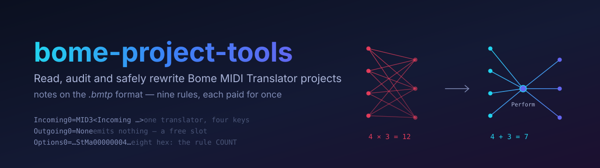
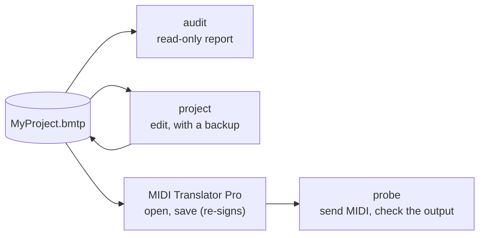

<p align="center"></p>

# bome-project-tools

[](https://github.com/Beennnn/bome-project-tools/actions/workflows/tests.yml)


[](LICENSE)

**Read, audit and safely rewrite [Bome MIDI Translator Pro](https://www.bome.com/products/miditranslator) project files (`.bmtp`), and prove on real MIDI that they do what you meant.**

For anyone whose MT Pro project has grown past what is comfortable to check by eye: a live rig, a studio router, a controller remap with dozens of translators.

> **Unofficial.** This project is not affiliated with Bome Software. Bome does not document the `.bmtp` format: everything here was worked out by editing real projects and reopening them in MIDI Translator Pro 1.9.2, and Bome's support team has helped correct parts of it on the [Bome forum](https://forum.bome.com/t/7925). Corrections are welcome.

## Why use it

MIDI Translator Pro is powerful enough that projects grow, and past a certain size four problems appear. Each module answers one of them.

| The problem | What you get |
| --- | --- |
| **A mistake is silent.** A translator that never matches does nothing, for the whole show, with no error and no log. | **`probe`** sends MIDI through the running MT Pro and checks what comes out — and checks that nothing comes out where nothing should. A case that observes nothing only passes if it said it expected silence, so a test aimed at the wrong channel does not slip through as a pass. |
| **Variables have invisible scope.** Two-letter names, only ten of them local: a global reused by two presets, or a stale value in a controller slot, becomes *All Notes Off* on stage. | **`audit`** reports, in one read-only pass, every variable's scope, collisions between presets, values read but never written, early exits that fire too soon, and messages that leak through the MIDI Router. |
| **Bulk edits are done by hand.** One outgoing action per translator: 7 triggers × 3 destinations is 21 translators to keep in sync. | **`project`** edits the file from Python: a backup before every write, a refusal while MT Pro is open, and an unchanged preset written back byte-identical, so a `diff` shows exactly your change. |
| **The format is undocumented.** | **This README** sets out every rule worked out so far, each paid for by a mistake once — see [The `.bmtp` format](#the-bmtp-format). |

Everything is plain Python with no dependency (only `probe` needs [`mido`](https://mido.readthedocs.io/) to talk MIDI), and 95 tests run on every change.

### How the pieces fit together



1. **Audit** the project to see what is risky before touching anything.
2. **Edit** it with `project` while MT Pro is closed, then review the `diff`.
3. **Open and save** it in MT Pro, which loads the change and signs the file again.
4. **Probe** it: send real MIDI through MT Pro and check every expected output and every expected silence.

## Contents

- [Why use it](#why-use-it)
- [Requirements](#requirements)
- [Quick start](#quick-start)
- [The audit](#the-audit)
- [Editing a project safely](#editing-a-project-safely)
- [Testing a project on real MIDI](#testing-a-project-on-real-midi)
- [The `.bmtp` format](#the-bmtp-format)
- [A pattern worth knowing: one trigger, many actions](#a-pattern-worth-knowing-one-trigger-many-actions)
- [Development](#development)
- [Limits](#limits)
- [Credits and license](#credits-and-license)

| Module | In one line |
| --- | --- |
| [`bome_project/project.py`](bome_project/project.py) | Read a project into objects (presets, translators, MIDI Router) and write a preset back safely. |
| [`bome_project/audit.py`](bome_project/audit.py) | The read-only report of the mistakes that turn into silence on stage. |
| [`bome_project/probe.py`](bome_project/probe.py) | Send MIDI through a running MT Pro and check what comes out — and what must not. |
| [`examples/midi_test_plan.py`](examples/midi_test_plan.py) | A short test plan to copy and adapt. |
| [`docs/variable-convention.md`](docs/variable-convention.md) | The variable naming convention the audit checks, with a [worked example](docs/variable-convention-example.md). |

## Requirements

- Python 3.9 or newer. The library itself uses the standard library only.
- [`mido`](https://mido.readthedocs.io/) and `python-rtmidi`, **only** for sending real MIDI with `probe`:

  ```bash
  pip install mido python-rtmidi
  ```

- MIDI Translator Pro for anything that touches a live configuration. The tools were verified against version 1.9.2 on macOS.

There is no package to install: clone the repository and run the tools from its root.

```bash
git clone https://github.com/Beennnn/bome-project-tools.git
cd bome-project-tools
```

## Quick start

List the presets of a project:

```python
from pathlib import Path
from bome_project.project import Project

proj = Project(Path("MyProject.bmtp"))
for number, preset in sorted(proj.presets.items()):
    state = "" if preset.active else "(inactive)"
    print(number, preset.name, len(preset.translators), "translators", state)
for route in proj.routes:
    print("router:", route.source, "->", route.destination)
```

Audit it:

```bash
python3 -m bome_project.audit MyProject.bmtp
```

## The audit

```bash
python3 -m bome_project.audit MyProject.bmtp
```

The audit only reads the file. Each section of the report answers one question:

| Section | What it reports | Why it matters |
| --- | --- | --- |
| `scope` | Every variable, classed as local, global or **UNDOCUMENTED**. | Only ten names are local. Everything else is global, including names that *look* local. |
| `collisions` | Globals written by more than one **active** preset. | Two presets writing the same global overwrite each other, in whatever order messages arrive. |
| `de-facto globals` | Variables a preset reads but never writes. | The value comes from somewhere else, which is easy to break without noticing. |
| `read but NEVER written` | Variables nothing ever assigns. | They are always 0. |
| `outgoing actions with a VARIABLE as controller number` | A variable in the controller slot of a Control Change. | If the variable holds a stale value in 120–127, the translator sends *All Notes Off* or *All Sound Off*. |
| `early exits that fire the outgoing action` | An `if(…)execute` that fires before a variable it needs is assigned. | The action is sent with whatever value was left over. Use `noexecute` when a branch means "send nothing". |
| `MIDI router` | The router's port-to-port connections. | Messages that travel without any translator. |
| `routed ports` | Translators on a routed input port that can exit with `noexecute`. | On that branch Bome sends the **raw** message on through the router. Often intended, never visible in the translator list. |

An example, on a small made-up project:

```console
$ python3 -m bome_project.audit MyProject.bmtp
MyProject.bmtp — 4 presets, 3 active

== scope ==
  UNDOCUMENTED  cu
  global        ga ka sg zz
  local         oo pp qq rr vv

== collisions: written by more than one ACTIVE preset ==
  ka   Preset.0 «Keys A» · Preset.1 «Keys B»
  -> 1

== read but NEVER written anywhere (always 0) ==
  cu ga

== early exits that fire the outgoing action ==
  Preset.0    ACTIVE Options0   'if(pp==0)execute' fires before ka/rr is assigned

== routed ports: where the RAW message still goes on through the router ==
  Preset.1   ACTIVE Keys B                       Incoming0  Keys -> Synth on its noexecute branch
```

(Some sections are shortened here.)

### Variable scope, in short

- **Locals** are exactly ten names: `oo pp qq rr ss tt uu vv ww xx`. They live for one incoming event of one translator, so two translators using `pp` never interfere.
- **Globals** are a head letter from `g h i j k l m n y z` followed by any character (`ga`, `g0`, `mz`…), **or** a head from `o` to `x` followed by a *different* character (`oa`, `pc`, `sg`…). Their doubled form (`oo`…`xx`) is the local.
- Anything else is reported as **UNDOCUMENTED**.

The naming convention the audit checks, and why, is in [`docs/variable-convention.md`](docs/variable-convention.md), with a [worked example](docs/variable-convention-example.md).

## Editing a project safely

```python
from pathlib import Path
from bome_project.project import Project, Translator

proj = Project(Path("MyProject.bmtp"))
preset = proj.presets[0]

# A copy of translator 0 that halves the value.
source = preset.translators[0]
copy = Translator()
copy.name = source.name + " (half value)"
copy.incoming, copy.outgoing = source.incoming, source.outgoing
copy.set_rules(["pp=pp/2"])
index = preset.add(copy)

backup = proj.write(0)  # rewrites preset 0 only
print(f"added translator {index}, backup in {backup.name}")
```

What a write guarantees:

- **It refuses to run while MIDI Translator Pro is open.** Bome keeps the project in memory and rewrites the whole file on its next save, so an edit made meanwhile would be lost. Closing the project window is not enough: the application has to quit.
- **It takes a backup first**, named `MyProject.bmtp.bak-<date>-<time>-p<preset>`. A backup is never overwritten, even for two writes in the same second.
- **Only the preset you write changes.** An unchanged preset is written back byte-identical, and an edit changes only its own lines, so a `diff` shows exactly what you did.
- **The signature becomes invalid.** MIDI Translator Pro still opens the file, but BomeBox and MT Player refuse it until you open the project in MIDI Translator Pro and save it, which signs it again.

The API in brief:

| Object | Use |
| --- | --- |
| `Project(path)` | `.presets` (dict by number), `.routes`, `.write(preset)`, `.is_signed()` |
| `Preset` | `.name`, `.active`, `.translators` (dict by index), `.add(t)`, `.remove([indices])` (renumbers) |
| `Translator` | `.name`, `.incoming`, `.outgoing`, `.options`, `.rules()`, `.set_rules([...])`, `.channel`, `.number`, `.in_ports` |
| `Route` | `.source`, `.destination` (read-only: see [Limits](#limits)) |

## Testing a project on real MIDI

A translator can only be tested by sending its incoming message and watching what comes out. That means you must be able to **write to the port it listens on**:

| The translator listens to | Testable by a script |
| --- | --- |
| a virtual MIDI port | **yes** |
| a hardware device | no: it needs a hand on the instrument |

A tip: a **port alias** makes hardware translators testable. Point the alias at the hardware, let translators inherit it from the preset's default port, and reassign the alias to a virtual port while testing. Two traps: Bome *expands* an alias into each incoming action instead of resolving it at run time, and a port named on the translator *overrides* the preset default.

[`examples/midi_test_plan.py`](examples/midi_test_plan.py) is a complete, short plan to copy and adapt. Its core:

```python
from bome_project.probe import Case, find_trigger, run, triggers

trigs = triggers(Path("MyProject.bmtp"))
t = find_trigger(trigs, preset=0, number=20)  # channel read from the project

cases = [
    Case(
        "CC20 -> CC7",
        send=mido.Message("control_change", channel=t.mido_channel, control=20, value=64),
        expected={(1, 7)},  # (channel 1-16, CC or note number) that must come out
    ),
    Case(
        "unmapped CC -> silence",
        send=mido.Message("control_change", channel=t.mido_channel, control=99),
        expect_silence=True,
    ),
]
failures = run("Virtual Bus", cases)  # prints a table, returns the count
```

Two rules make a plan trustworthy:

1. **Read channels and numbers from the project** with `find_trigger` / `find_any` instead of retyping them. The channel is 0-based in the file (see below), and a plan that retypes numbers drifts away from the configuration it claims to test. `Trigger.mido_channel` gives the channel the way `mido` counts it, and raises if the trigger listens on any channel.
2. **Declare the silences you expect** with `expect_silence=True`. A case that declares nothing **fails** when nothing comes out: a plan aimed at the wrong channel observes nothing everywhere, and that must never read as a pass.

MIDI Translator Pro must be running during the test: without it nothing translates, and a run of pure silence cannot be told apart from a broken configuration.

## The `.bmtp` format

A project is a text file of sections:

```
; ------- Bome MIDI Translator: signed project file
;
[MIDI.routes]                  optional: the MIDI Router
In0=Keyboard In
Out0=DAW

[Preset.0]
Active=1
Name=Controllers               the PRESET name, no index
Incoming0=MID3<Incoming …>     one translator per INDEX, spread over four keys
Name0=CC20 -> CC7              translator 0's name
Options0=Actv01Stop00OutO00StMa00000001pp=pp/2
Outgoing0=MID3<Outgoing …>
PresetSwitchIgnore=0

[Project]
DefaultInPorts=MIDA0000

[Signatures]
…
```

What we learnt, each point the hard way:

1. **A translator is spread over four indexed keys**: `Name<N>`, `Incoming<N>`, `Outgoing<N>`, `Options<N>`. Touching one means reading all four.
2. **Keys are sorted as text, not as numbers**: `Name`, `Name0`, `Name1`, `Name10`, `Name11`, `Name2`… Any other order still loads, but Bome rewrites the whole preset on its next save, which buries your change in a noisy diff.
3. **Numbering must be contiguous.** Deleting translator 11 of 39 means renumbering the 27 that follow, across all four keys. `Preset.remove` does it.
4. **`Outgoing<N>=None`**, the literal string, is a translator that sends nothing. It only sets variables through its rules.
5. **The channel is 0-based**: `<Channel num="11"/>` is channel **12**. An adjacent `Type="Any"` means any channel.
6. **`Options` is a fixed-length record followed by the rules**: `Actv01` (active), `Stop00` (does not stop processing), `OutO00` (outgoing options), then `StMa` and **eight upper-case hex digits giving the number of rules**, then the rules with no separator. With a wrong count, the extra rules are silently ignored.
7. **A prefix names the action type**: `MID3` for MIDI (XML), `Prfm` for a Perform. `MID2` is an older MIDI form still written for raw patterns: a port list, then one byte per two characters, either upper-case hex (`F0`) or a variable (`pp`). An incoming pattern *captures* its variables, an outgoing one *sends* them.
8. **Port lists** (`DefaultInPorts`, `DefaultOutPorts`, `MID2` actions) are encoded as `MIDA`, the number of ports in four hex digits, then each name preceded by its length in four hex digits: `MIDA00010007Ableton` is one port, "Ableton". `MIDA0000` means none.
9. **The MIDI Router lives in the project**, in `[MIDI.routes]` before the first preset, as `In<N>` / `Out<N>` pairs (one destination per pair). It sends messages port to port without any translator, and without remapping.
10. **Sections come after the last preset** (`[Project]`, `[Signatures]`): a preset ends at the next section of any kind, not at the next preset.
11. **Bome rewrites the file from memory on save**, and **editing invalidates the signature** (see [Editing a project safely](#editing-a-project-safely)).

## A pattern worth knowing: one trigger, many actions

A translator has one outgoing action, so *N* triggers that must each reach *M* destinations cost *N × M* translators. A **Perform**, a named event internal to Bome, turns that product into a sum: each trigger emits the event, and every translator listening for its name fires.

```
before                21 translators     7 triggers × 3 destinations
after                 10                 7 emit the event + 3 execute it
a fourth destination  +1 instead of +7
```

The Bome manual recommends a Perform over a 0 ms one-shot timer for this, and a Perform is never retriggered. Its parameters carry values, so each destination can filter on what the trigger sent instead of needing its own copy.

## Development

```bash
python3 -m unittest                      # the tests: standard library only
pip install -r requirements-dev.txt      # the pinned lint and type-check tools
ruff check .
ruff format .                            # the CI runs it with --check
mypy
```

- **Tests** run on made-up projects whose lines copy the shapes MIDI Translator Pro writes. `probe` is tested through a fake MIDI port, so the suite needs neither `mido` nor MIDI Translator Pro.
- **CI** ([`.github/workflows/tests.yml`](.github/workflows/tests.yml)) runs on every push and pull request: the tests on Python 3.9 to 3.14 (Linux) and on macOS, [ruff](https://docs.astral.sh/ruff/) lint and format checks ([`ruff.toml`](ruff.toml)), and [mypy](https://mypy-lang.org/) ([`mypy.ini`](mypy.ini)).
- **Pinned versions**: GitHub Actions are pinned by commit SHA and the tools in [`requirements-dev.txt`](requirements-dev.txt); Dependabot proposes the updates.
- `.git-blame-ignore-revs` lists the one commit that only reformatted the code. To skip it locally in `git blame`: `git config blame.ignoreRevsFile .git-blame-ignore-revs`.
- Notes for contributors and coding agents are in [`CLAUDE.md`](CLAUDE.md).

## Limits

- **Verified on one version**, MIDI Translator Pro 1.9.2 on macOS. Some format details (the router, `MID2`) were seen in only a few projects; the readers refuse any shape they have not seen rather than guess.
- **The MIDI Router is read, never written.** A project has a handful of routes, which Bome's own editor changes faster than a script would.
- **Nothing reads the settings file** (`.bmts`), which holds the application's ports and aliases rather than the project.

## Credits and license

Thanks to Steve Caldwell of Bome, who corrected parts of the variable-scope rules, and to Florian of Bome for his feedback, on the [Bome forum](https://forum.bome.com/t/7925).

This repository replaces the earlier `bome-variable-naming` repository, whose audit and convention now live here.

[MIT](LICENSE).
